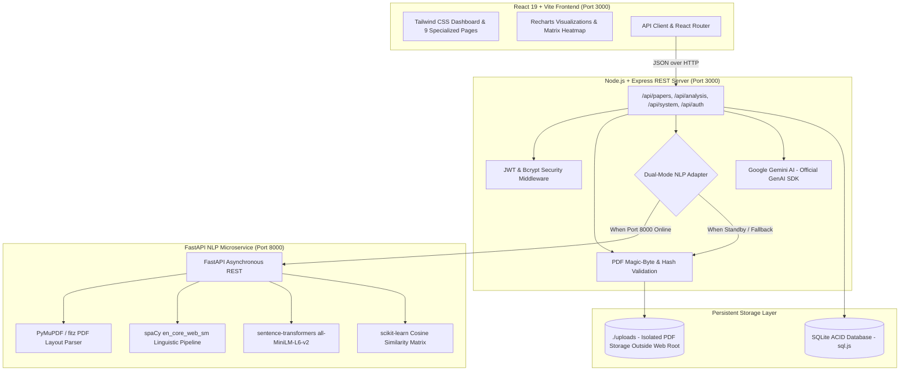

# AI-Powered Research Gap Discovery Platform

A full-stack academic research intelligence platform enabling students and researchers to upload research papers in PDF format, extract and analyze their contents using Artificial Intelligence (Google Gemini API) and Natural Language Processing (PyMuPDF, spaCy, sentence-transformers, and scikit-learn), compare multi-paper methodologies, identify candidate research gaps with verifiable ground-truth evidence, and recommend doctoral-grade future research directions.

---

## 1. System Architecture



---

## 2. Key Modules & Functional Capabilities

1. **Dashboard Overview (`/`)**: Displays live database-derived statistics: indexed papers, completed deep analyses, identified evidenced research gaps, and pending pipeline tasks. Features dynamic domain distribution and severity breakdown charts.
2. **Upload Research Papers (`/upload`)**: Drag-and-drop & file picker with strict magic-byte (`%PDF-`) and 20MB file size validation, SHA-256 deduplication, non-guessable storage identifiers, and automatic background extraction triggers.
3. **My Research Library (`/library`)**: Searchable, filterable repository with status indicators, secure paper download streaming, metadata inspection drawer, and deletion controls.
4. **Deep Paper Analysis (`/analyze`)**: Structural decomposition of scientific papers extracting objectives, architectures, models, datasets, evaluation metrics, author-stated limitations, threats to validity, and references.
5. **Research Gap Discovery (`/gaps`)**: Comparative synthesis across repository literature. Every identified gap is backed by cited ground-truth quotes, section names, page numbers, and validation statuses (*Candidate*, *Validated*, *Refuted*).
6. **Cross-Paper Comparison Matrix (`/compare`)**: Multi-paper alignment showing pairwise semantic cosine similarity heatmaps, common themes, and methodological divergence points.
7. **Future Research Recommendations (`/recommendations`)**: Actionable future research directions linking proposed methodologies, expected impact, feasibility ratings, engineering hurdles, and suggested benchmark datasets, with one-click Markdown export.
8. **Analysis Audit History (`/history`)**: Immutable activity log documenting document ingestions, LLM extractions, gap syntheses, and recommendation generations.
9. **Settings & Viva Project Guide (`/settings`)**: Real-time system telemetry (SQLite disk health, Gemini API configuration, Python microservice connectivity, storage usage) and complete viva defense preparation notes.

---

## 3. Technology Stack

- **Frontend**: React 19, Vite, Tailwind CSS v4, Lucide React, Recharts, React Router v7.
- **Backend**: Node.js v22, Express.js 4, Multer, Bcrypt.js, JsonWebToken.
- **Database**: SQLite (ACID-compliant WebAssembly `sql.js` with automated disk persistence).
- **AI Engine**: Google Gemini API via the official `@google/genai` TypeScript SDK (`gemini-3.8-flash` with strict `Type.OBJECT` schema enforcement).
- **NLP Service**: Python 3.10+, FastAPI, PyMuPDF (`fitz`), spaCy, `sentence-transformers`, `scikit-learn`.
- **Testing**: Vitest for frontend & backend unit tests, Pytest for Python NLP endpoints.

---

## 4. Setup & Installation

### Prerequisites
- Node.js >= 18.0.0
- Python >= 3.10 (optional, for external FastAPI microservice)
- Google Gemini API Key

### Step 1: Clone and Install Node.js Dependencies
```bash
npm install
```

### Step 2: Configure Environment Variables
Copy the sample environment file:
```bash
cp .env.example .env
```
Ensure your Gemini API key is configured:
```env
GEMINI_API_KEY="your-google-gemini-api-key"
PORT=3000
FASTAPI_NLP_URL="http://127.0.0.1:8000"
```

### Step 3: Run Full-Stack Node.js Application
```bash
npm run dev
```
The application runs on `http://localhost:3000`.

### Step 4 (Optional): Start Python FastAPI NLP Microservice
To activate the external PyMuPDF and sentence-transformers service:
```bash
cd nlp_service
python3 -m venv venv
source venv/bin/activate
pip install -r requirements.txt
python -m spacy download en_core_web_sm
uvicorn main:app --host 0.0.0.0 --port 8000 --reload
```
*Note: If the Python service is offline, the platform's intelligent adapter automatically executes native Node.js PDF extraction and TF-IDF similarity without interruption.*

---

## 5. Running Automated Tests

Run backend and component integration tests:
```bash
npm run test
```

Run Python microservice tests (inside `nlp_service/`):
```bash
pytest test_nlp.py -v
```

---

## 6. Synthetic Demonstration Dataset Notice

The platform includes an original synthetic demonstration benchmark dataset (`server/db/seed.ts`) explicitly labeled as synthetic research papers:
1. *[Synthetic Dataset] Edge-Assisted Federated Learning in Latency-Constrained Telehealth Networks*
2. *[Synthetic Dataset] Adaptive 4-Bit Quantization for Transformer-Based Bio-Signal Processing on Ultra-Low-Power Wearables*
3. *[Synthetic Dataset] Multi-Modal Graph Contrastive Learning for Longitudinal Rare Disease Trajectory Prediction*

These synthetic benchmark papers allow examiners and researchers to evaluate the full pipeline (PDF downloading, section extraction, cross-paper comparison, evidenced gap identification, and recommendation formulation) immediately without uploading proprietary data.
